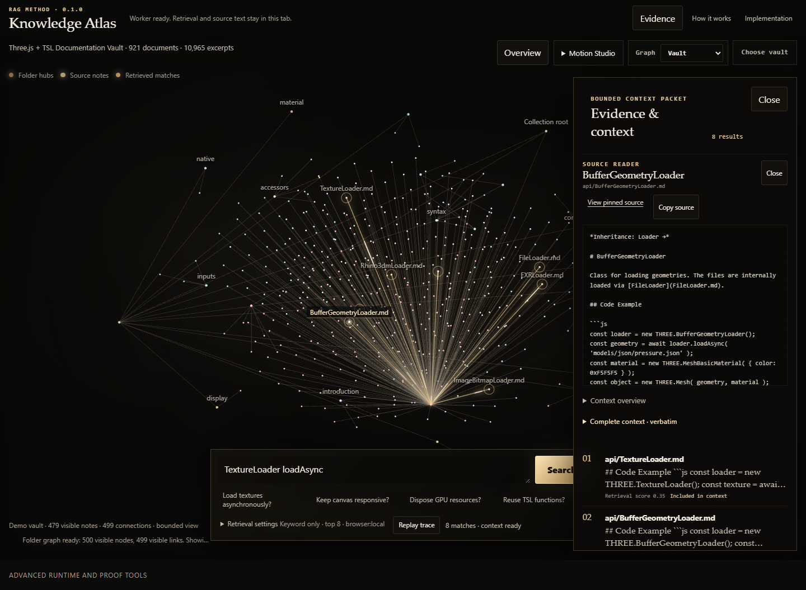

# RAG Method

An inspectable retrieval method and two working applications for exploring source-backed knowledge. RAG Method makes indexing, ranking, provenance, and the context selected for a model visible and reproducible.

The repository owns the language-neutral `rag-indexing-v1` and `rag-behavior-v2` contracts, a Python reference implementation, and a browser-native TypeScript implementation. Graph layout and rendering come from the separately reusable `@ours/forcegraph-tsl` library; a graph view never changes retrieval scores.



## Explore Knowledge Atlas

The browser application includes a pinned 921-document Three.js and TSL documentation vault. Load the example, ask a suggested question, follow ranked evidence through the graph, read the complete source, and inspect the exact context a model would receive. You can also select your own bounded Markdown/text files or an Obsidian folder. Selected files stay in the browser Worker session: there is no upload, database, or model call.

Use Node.js 22.12 or newer with npm. Dependency setup is an explicit action:

```text
node run.mjs setup-browser
node run.mjs run-browser
```

Open the loopback URL printed by Vite, then choose **Open Atlas**. The root menu is also available through `run.cmd` on Windows or `node run.mjs` in a terminal. Use `node run.mjs --list` to inspect tasks and `--dry-run` to inspect their commands.

**Motion Studio → Replay build** replays the accepted graph with bounded node growth and camera motion. Quiet mode and reduced-motion preferences take priority. Animation presents actual ranked matches and source relationships; it does not measure retrieval speed. Open **Evidence** to inspect a complete source or copy the ordered context packet.

## Explore the local Lab

RAG Method Lab pairs a bounded FastAPI backend with a React frontend. Load its built-in synthetic collection, compare retrieval modes, inspect backend-owned scores and source provenance, select evidence in the graph, and export a validated query report. Advanced tools disclose detailed controls while the initial view stays focused on the query and evidence.

The locked backend setup is tested with **Python 3.12**. NumPy `2.5.1` in `requirements.lock` requires Python 3.12 or newer; the range-based development manifest has a separate `>=3.10` runtime declaration. Start with the [setup guide](docs/user/SETUP.md).

## Read and verify

- [Method and ownership](docs/METHOD.md): frozen contracts, reference behavior, and application boundaries.
- [Setup and user journeys](docs/user/SETUP.md): browser explorer and local Lab.
- [Development commands](docs/DEVELOPMENT.md): tests, builds, conformance, and corpus maintenance.
- [Release and redistribution](docs/RELEASE.md): source fingerprints, public-surface policy, and licenses.
- [Backend integration contract](docs/dev/RAG_CONTRACT.md): routes, limits, authentication, and storage.

`node run.mjs test-browser-unit` checks the browser implementation; `node run.mjs test-method` runs the frozen Python conformance cases. Browser journeys are explicit tasks and use an installed local Chromium browser when available. Run/test/build tasks do not install packages, fetch documentation, or download models.

The default demonstrations are model-free. They show real retrieval and context assembly rather than generated answers. Semantic model setup, authenticated remote browser access, persistence in the browser explorer, and large-corpus performance are outside this release's demonstrated scope.

MIT licensed. The pinned graph archive, Three.js runtime, and redistributed Three.js documentation retain their own MIT notices. See [THIRD_PARTY_NOTICES.md](THIRD_PARTY_NOTICES.md).
