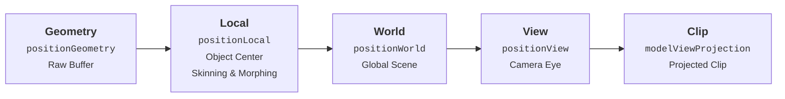

# Coordinate Spaces

TSL provides dedicated accessor nodes to query geometric properties — such as positions, normals, tangents, and bitangents — across each stage of the GPU transformation pipeline.

Understanding coordinate spaces is essential for procedural shading, lighting calculations, triplanar texturing, normal mapping, and view-dependent effects.

### MVP Pipeline (Model - View - Projection)

The standard rendering pipeline transforms vertex positions forward through **Model**, **View**, and **Projection** matrices:

### Coordinate Spaces Overview

| Space | Origin | Description & Use Cases |
| :--- | :--- | :--- |
| **Geometry** | Raw buffer | Raw, unmodified vertex attribute buffer before any CPU or GPU transformations. Ideal for rest-pose computations and base coordinate derivations. |
| **Local (Object)** | Mesh object | Object-space coordinates after applying GPU transformations (skeletal skinning, blend shapes, morph targets). Used for procedural textures that transform with the mesh. |
| **World** | Scene global | Global scene coordinates. Essential for scene lighting, shadow projections, world-space reflections, triplanar mapping, and cross-object interactions. |
| **View (Camera)** | Active camera eye position | Coordinates relative to the camera eye. Essential for Fresnel edge glow, view-dependent specular highlights, matcaps, and camera distance effects. |
