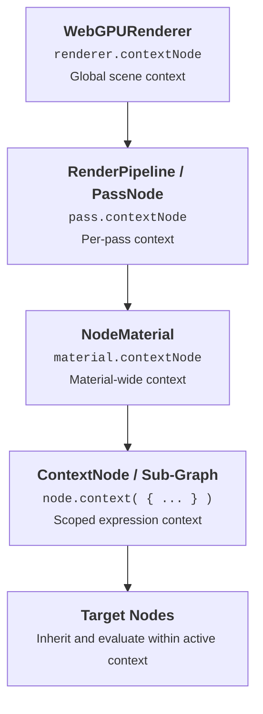

# Context

In TSL, `ContextNode` is a cascading configuration and environment system that flows downward through the node graph (Abstract Syntax Tree) during compilation.

It allows materials, render passes, and individual sub-graphs to inject configuration parameters, override global behaviors (such as UV coordinates, shadow sampling, or ambient occlusion), and assign custom variable names without modifying the underlying nodes.

<code name="contextExample" default="true">Context Showcase</code>

::: api context( nodeOrValue, value ) : ContextNode - Wraps a node with contextual dictionary data that flows downward to all child nodes during compilation.
- **nodeOrValue**: `Node | Object` - The target node to wrap, or the context dictionary object if creating a standalone context wrapper.
- **value**: `Object` - Key-value dictionary containing contextual parameters and hooks.
:::

::: api .context( value ) : ContextNode - Method chaining helper to wrap the current node expression with contextual data. :::

### Context Properties

::: api getUV : Function - Callback `( builder ) => Node` to override the UV coordinate used by all textures and UV-dependent nodes in the active sub-tree. :::

::: api getShadow : Function - Callback `( { light, shadowColorNode } ) => Node` to customize or filter shadow calculations across the contextual sub-tree. :::

::: api getAO : Function - Callback `( inputNode, { material } ) => Node` to customize or modulate ambient occlusion evaluation across the sub-tree. :::

### Context Hierarchy Cascade

Context configuration flows downward from the highest level of the rendering engine down to individual node expressions:



#### Overriding UVs for All Child Textures
Assigning `getUV` to `material.contextNode` or wrapping an expression automatically redirects texture sampling across the entire sub-tree:

```js
import * as THREE from 'three';
import { uv, vec2, time, texture } from 'three/tsl';

const map = new THREE.TextureLoader().load( '../examples/textures/uv_grid_opengl.jpg' );
map.wrapS = THREE.RepeatWrapping;
map.wrapT = THREE.RepeatWrapping;

// Dynamic animated and scaled UV coordinates
const animatedUV = uv().mul( 3.0 ).add( vec2( time.mul( 0.2 ), 0.0 ) );

// All textures in this material automatically use animatedUV instead of standard uv()
material.contextNode = material.context( {
	getUV: () => animatedUV
} );

material.colorNode = texture( map );
```

```tsl contextExample
import 'scenes/shaderball';
import * as THREE from 'three';
import { uv, time, texture, vec2 } from 'three/tsl';

// Load texture map
const map = new THREE.TextureLoader().load( '../examples/textures/uv_grid_opengl.jpg' );
map.wrapS = THREE.RepeatWrapping;
map.wrapT = THREE.RepeatWrapping;

// 1. Custom animated and scaled UV coordinates
const animatedUV = uv().mul( 3.0 ).add( vec2( time.mul( 0.2 ), 0.0 ) );

// 2. Wrap material context to redirect getUV for all textures across the material
model.material.contextNode = uv().context( {
	getUV: () => animatedUV
} );

// 3. Texture sampling automatically inherits the contextual animated UVs
model.material.colorNode = texture( map );
model.material.roughness = 0.2;
model.material.metalness = 0.5;
```
