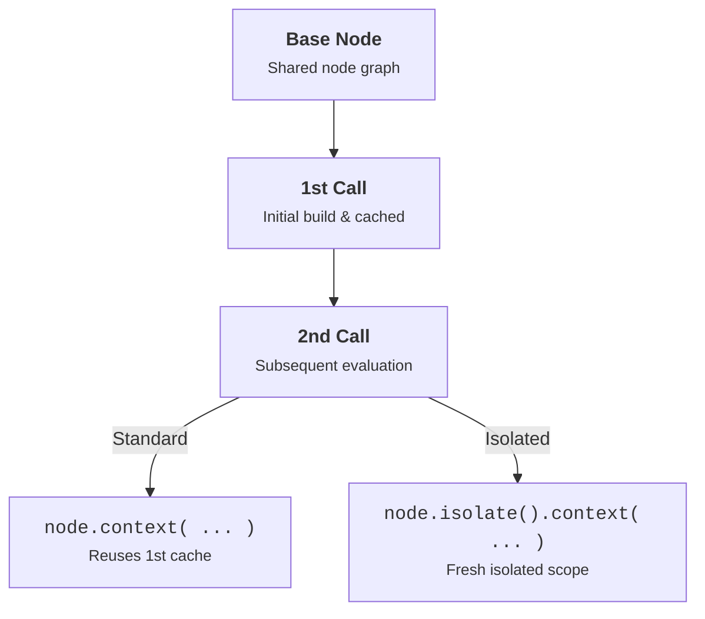

# Isolate

By default, TSL automatically caches node evaluations. If you use the same node in multiple places, TSL builds it once and reuses the result to avoid redundant GPU calculations.

However, if you want to evaluate the **same node** under different parameters (such as sampling a texture at different UV scales or offsets with `.context()`), the default caching will return the first evaluation and ignore your changes.

`isolate( node )` or `.isolate()` tells TSL to create an **isolated cache scope**, forcing the node to be evaluated fresh without reusing or overwriting existing cache data.

::: api isolate( node: Node ) : IsolateNode - Creates an isolated cache wrapper for a node.
- **node**: `Node` - The node whose evaluation cache should be isolated.
:::

::: api .isolate() : IsolateNode - Method chaining helper to create an isolated cache wrapper.
:::

### Caching vs Isolate



### When to Use

Use `isolate()` whenever you need to recreate or re-evaluate a node's code flow under a different context. Because TSL caches and reuses previously built expressions by default, wrapping a node with `.isolate()` allows its entire sub-graph to be built fresh in a separate scope—enabling you to safely apply new contextual parameters.

```tsl
import 'scenes/shaderball';
import * as THREE from 'three';
import { texture, uv, vec2, time } from 'three/tsl';

// Load base texture map
const map = new THREE.TextureLoader().load( '../examples/textures/uv_grid_opengl.jpg' );
map.wrapS = THREE.RepeatWrapping;
map.wrapT = THREE.RepeatWrapping;

const textureNode = texture( map );

// Sample the same textureNode with different UV coordinates using .isolate()
const sampleLayer = ( scale, offset ) => {

	return textureNode.isolate().context( {
		getUV: () => uv().mul( scale ).add( offset )
	} );

};

// Base texture layer with slow horizontal drift
const baseLayer = sampleLayer( 1.0, vec2( time.mul( 0.05 ), 0.0 ) );

// Detail texture layer with 4x scaling and vertical drift
const detailLayer = sampleLayer( 4.0, vec2( 0.0, time.mul( 0.1 ) ) );

// Composite layers together on the shaderball material
const composite = baseLayer.rgb.mul( detailLayer.rgb.add( 0.3 ) );

model.material.colorNode = composite;
model.material.roughnessNode = detailLayer.r.mul( 0.4 );
```
