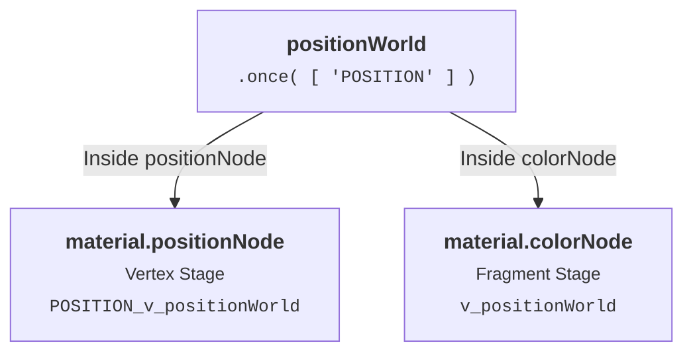

# Sub-Builds

Calling `.once()` on a `Fn()` creates a **singleton function**: TSL evaluates it once and reuses the result across your shader graph.

**Sub-Builds** solve this by creating scoped compilation layers (like `'POSITION'` or `'NORMAL'`). Passing `.once( [ 'POSITION' ] )` tells TSL to maintain a separate cache for that specific stage instead of reusing a single global value.

::: api fn.once( subBuilds: Array<string> = null ) : FunctionNode - Configures a TSL function, `fn`, to execute and cache its output node once per build, with optional isolated caching across specified sub-build layers.
- **subBuilds**: `Array<string>` - (Optional) Array of sub-build layer names (e.g. `[ 'NORMAL', 'VERTEX' ]`) under which the function is cached independently.
:::

::: api subBuild( node: Node, name: string, type: string = null ) : SubBuildNode - Wraps a node to be built within an isolated sub-build scope (e.g. `'VERTEX'`, `'NORMAL'`, `'POSITION'`).
- **node**: `Node` - The target node to evaluate inside the sub-build layer.
- **name**: `string` - The name of the sub-build compilation layer.
- **type**: `string` - (Optional) The output type of the node.
:::

::: api builder.getSubBuildProperty( property: string = '', node: Node = null ) : string - Returns a sub-build prefixed property or varying identifier (e.g. `'POSITION_v_positionWorld'`).
- **property**: `string` - The base property or varying name to prefix.
- **node**: `Node` - (Optional) Target node used to resolve the closest sub-build scope.
:::

### How `positionWorld` Works

Here is the core implementation of `positionWorld` in Three.js:

```js
export const positionWorld = /*@__PURE__*/ ( Fn( ( builder ) => {

	return modelWorldMatrix.mul( positionLocal ).xyz.toVarying( builder.getSubBuildProperty( 'v_positionWorld' ) );

}, 'vec3' ).once( [ 'POSITION' ] ) )();
```

When `positionWorld` is used in both `material.positionNode` and `material.colorNode`, TSL manages the compilation flow through sub-builds:

1. `material.positionNode`: Runs inside the `'POSITION'` sub-build. `positionWorld` evaluates in the vertex stage and caches it under `'POSITION'` as `'POSITION_v_positionWorld'`.
2. `material.colorNode`: Runs in the default fragment scope. Because `positionWorld` is only cached for `'POSITION'`, TSL evaluates it again for the fragment stage and outputs `'v_positionWorld'`.



<code name="positionWorldSubBuildExample" default="true">Sub-Builds Showcase</code>

```tsl positionWorldSubBuildExample
import 'scenes/shaderball';
import { positionLocal, positionWorld, normalLocal, time, color } from 'three/tsl';

// 1. Modify vertex positions using world coordinates
const wave = positionWorld.y.mul( 6.0 ).add( time.mul( 2.5 ) ).sin().mul( 0.08 );
model.material.positionNode = positionLocal.add( normalLocal.mul( wave ) );

// 2. Color surface based on the resulting world coordinates in fragment stage
const waveFactor = positionWorld.y.mul( 6.0 ).add( time.mul( 2.5 ) ).sin().mul( 0.5 ).add( 0.5 );
const waveColor = color( 0x00aaff ).mix( color( 0xff0066 ), waveFactor );

model.material.colorNode = waveColor;
model.material.roughness = 0.2;
```

### Sub-Build API Reference

| API | Type | Description |
| :--- | :--- | :--- |
| `Fn( function ).once( subBuilds )` | Method | Caches function evaluation per shader build, partitioned by `subBuilds` array. |
| `subBuild( node, name, type )` | Node Function | Wraps a node to be evaluated within an isolated sub-build scope. |
| `builder.subBuildFn` | Property | Identifies the active sub-build layer name currently executing. |
| `builder.getSubBuildProperty( prop, node )` | Method | Returns a sub-build prefixed identifier (e.g. `'POSITION_v_positionWorld'`). |

#### Related
- [Isolate](#isolate)
- [Context](#context)
- [Function](#function)
- [Shader Stages](#shader-stages)
