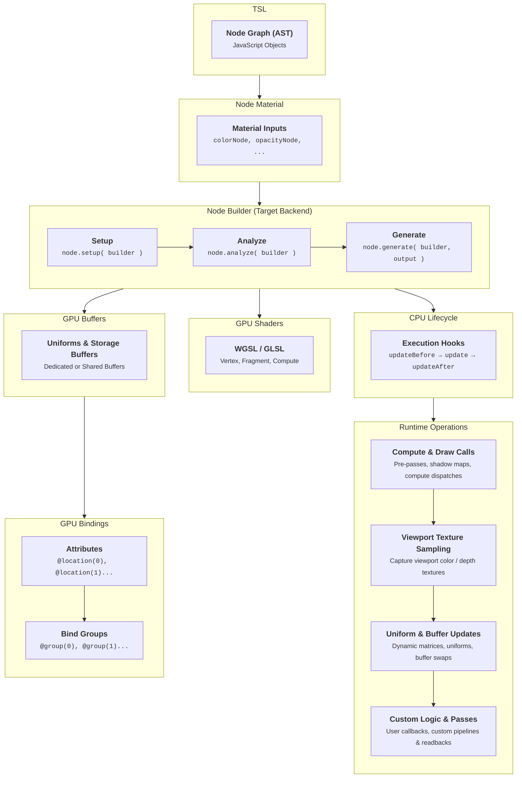

# Architecture

All TSL components extend from the `Node` class. A `Node` can communicate with other nodes, value conversions can be automatic or manual, and a `Node` can receive the output value expected by the parent `Node` and modify its own output snippet. It's possible to modularize them using tree shaking in the shader construction process. The `Node` has access to contextual information such as geometry, material, renderer, and graphics backend, which can influence the type and value of its output.

The main class responsible for creating the code and pipeline configuration is `NodeBuilder`. This class can be extended to any output programming language, so you can use TSL for a third language if you wish. Currently, `NodeBuilder` has two concrete implementations: `WGSLNodeBuilder` for WebGPU and `GLSLNodeBuilder` for WebGL2.

Beyond generating shader source code, `NodeBuilder` orchestrates GPU memory allocation and pipeline layouts: GPU buffers (uniform buffers, storage buffers, and attributes) can be dedicated per-object or shared across multiple materials and passes, avoiding redundant GPU memory allocations and state transitions.

### Compilation Process

The build process is based on three pillars: setup, analyze and generate.

### Node

The `Node` class is the fundamental abstraction representing every operation, value, texture sample, uniform, and expression within the TSL shading graph. Each node defines its own sub-graph, manages how it is compiled into backend shader code, and interfaces with the compilation pipeline through three primary stages:

::: api .setup( builder ) : Node - Use TSL to create customized logic for the node output, transforming expressions into child node connections. :::

::: api .analyze( builder, output ) : void - Analyzes the node graph to determine reference counts and assign cached variables for optimization. :::

::: api .generate( builder, output ) : string - Emits and returns the concrete shader code string snippet for the active graphics backend. :::

### Update Events & Lifecycle

Nodes can manage CPU-side operations and synchronize data with the GPU during the rendering loop through lifecycle hooks and execution frequency properties:

::: api .updateBeforeType : NodeUpdateType - The update frequency for `.updateBefore()`, executed before rendering begins. :::

::: api .updateType : NodeUpdateType - The update frequency ('frame', 'render', 'object') for `.update()`. :::

::: api .updateAfterType : NodeUpdateType - The update frequency for `.updateAfter()`, executed after rendering completes. :::

::: api .updateBefore( frame ) : void - Executed before rendering operations begin. Ideal for pre-pass setup, allocating dynamic storage buffers and render targets, or evaluating simulation states. :::

::: api .update( frame ) : void - Executed during object preparation right before drawing. Used to update node uniforms, animation matrices, or dynamic parameters. :::

::: api .updateAfter( frame ) : void - Executed after rendering operations have completed. Used for post-render cleanup, ping-pong buffer swaps, or GPU readbacks. :::

#### Update Frequencies

Constants defined in `NodeUpdateType` controlling the execution frequency of update properties:

::: api NodeUpdateType.NONE : string - The update method is disabled and will not be executed ('none'). :::

::: api NodeUpdateType.FRAME : string - Executed once per animation frame (per requestAnimationFrame tick) ('frame'). :::

::: api NodeUpdateType.RENDER : string - Executed once per renderer.render() call (useful for multi-pass rendering, shadow maps, and cubemaps) ('render'). :::

::: api NodeUpdateType.OBJECT : string - Executed once per individual Object3D drawn with the material or node ('object'). :::

### Serialization

Nodes support JSON-based serialization and deserialization, allowing entire node graphs, materials, and custom shader configurations to be saved to disk, shared across projects, or integrated with visual node editors:

::: api .serialize( json ) : object - Serializes the node structure and connections into a JSON object for storage, material exchange, or visual node editors. :::

::: api .deserialize( json ) : void - Restores the node state and connections from a serialized JSON representation. :::
