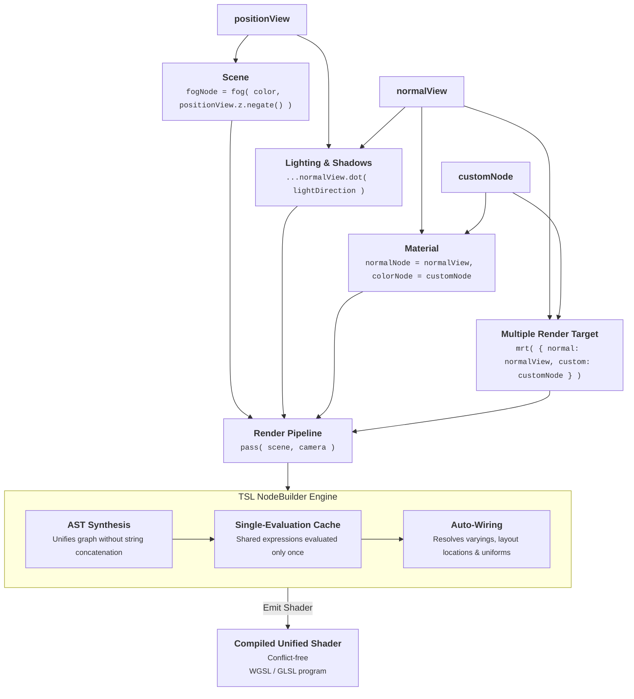

# Component-Based

TSL (Three.js Shading Language) elevates shader development from a monolithic script model to a **Component-Based Architecture**, allowing developers to maintain and share individual parts of the shader and rendering pipeline independently, scalably, and without collisions.

### Architectural Approaches

| Aspect | Traditional Shaders (Direct GPU Code) | Node System (TSL Abstraction) |
| --- | --- | --- |
| **Structure** | Text-based programs (GLSL / WGSL source files) | Composable JavaScript node graph (AST) |
| **Workflow** | Direct imperative shader code (`main()`, explicit steps) | Declarative channel assignment (`colorNode`, `normalNode`, etc.) |
| **Pipeline Integration** | Focuses strictly on per-draw GPU execution | Extends to multi-pass orchestration, compute stages, and CPU hooks |
| **Scope & Sharing** | Uniforms and bindings are scoped to individual programs | Nodes and uniforms can be shared across materials, MRT, and post-processing |
| **Stage Interfacing** | Manual declaration and management of varyings across stages | Automatic varying allocation and stage routing (e.g. `.toVertexStage()`) |
| **Backend Target** | Written specifically for a single backend (e.g. GLSL or WGSL) | Backend-agnostic; compiles automatically to WGSL or GLSL |

### Imperative Code vs. Declarative Nodes

- **Direct Imperative Shaders (GLSL / WGSL)**:
  Developers write explicit, step-by-step instructions executed sequentially inside stage entry points like `void main()` or `@fragment fn main()`. Variables, varyings, texture sampling, and output registers (`gl_FragColor` / `@location(0)`) must be manually declared and wired:

  ```glsl
  // Uniforms and varyings must be manually declared and managed
  uniform vec3 uLightDirection;
  uniform vec3 uBaseColor;

  varying vec3 vNormal;

  // Imperative step-by-step instructions in entry point
  void main() {

  	vec3 normal = normalize( vNormal );
  	float diff = max( dot( normal, uLightDirection ), 0.0 );

  	gl_FragColor = vec4( uBaseColor * diff, 1.0 );

  }
  ```

- **Declarative Node System (TSL)**:
  Developers declare *what* each channel or material should compute by assigning composable nodes. `NodeBuilder` automatically resolves execution stages, routes varyings, deduplicates calculations into cached variables, and synthesizes the optimal GPU program:

  ```js
  import * as THREE from 'three';
  import { normalView, uniform } from 'three/tsl';

  // Declarative component assignment
  const lightDirection = uniform( new THREE.Vector3( 0.0, 1.0, 0.0 ) );
  const baseColor = uniform( new THREE.Color( 0x0066ff ) );

  const diff = normalView.dot( lightDirection ).max( 0.0 );

  material.colorNode = baseColor.mul( diff );
  ```

### Component-Based Design

In TSL, materials and rendering pipelines are built by composing independent node components:

- **Modular Maintenance**: Individual shading components (e.g. lighting, diffuse color, normal evaluation) are maintained independently, avoiding variable name collisions and layout conflicts.
- **Cross-Pipeline Sharing**: A single node or uniform instance can be connected simultaneously to surface materials, deferred MRT channels, post-processing passes `pass( scene, camera )`, and compute shaders.
- **Rendering Orchestration**: Nodes can interact with the broader pipeline by scheduling compute dispatches, requesting viewport textures `viewportSharedTexture`, and hooking into CPU lifecycle events (`updateBefore`, `update`, `updateAfter`).
- **Graph Compilation & Optimization**: `NodeBuilder` analyzes the dependency graph, deduplicates repeated expressions, and generates optimized, backend-specific GPU programs.


